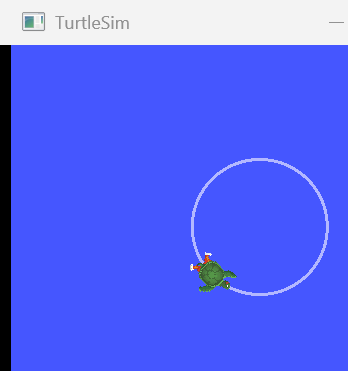

# patrol-robot-ros2

「校园巡检机器人无线充电对位系统」项目 **M1（全员共同月：Linux + ROS 2 实操）** 的实训与验收工作区。

M1 的检查点是一句话：

> **不看教程能独立做出「launch 拉起 画圆 + 打印位姿 + 录包」三个节点。**

这个工作区把它拆成四周递进的代码、一条命令的验收脚本，和一份能贴进月末例会的报告。

---

## 快速开始（Ubuntu 22.04）

```bash
git clone https://github.com/BewusstseinEwigkeit/patrol-robot-ros2.git
cd patrol-robot-ros2

bash scripts/setup_ubuntu_ros2.sh     # 装 ROS 2 Humble（已装会跳过）
source /opt/ros/humble/setup.bash
bash scripts/check_env.sh             # 环境自检
bash scripts/build.sh && source install/setup.bash
bash scripts/acceptance.sh all        # 一键验收
```

最后一条全绿，M1 的检查点就算拿到了。

> 路径提示：下面文档里的 `/media/<你的用户名>/...` 只是示例，
> 换成你自己的仓库位置即可。

---

## 里面有什么

| 目录 | 内容 |
|---|---|
| `src/m1_turtle_basics` | W1：命令行/键盘遥控 turtlesim + service 瞬移 |
| `src/m1_pubsub_demo` | W2：发布订阅画圆节点 + 位姿轨迹统计 |
| `src/m1_bringup` | W3：launch 参数化编排 + rosbag 录放 |
| `src/m1_tf2_demo` | W4：tf2 坐标树 `world→odom→base_link→imu_link/camera_link` |
| `scripts/` | 环境搭建、自检、编译、一键验收、rosbag 救包工具 |
| `tests/` | 31 项不依赖 ROS 的单元测试 |
| `docs/` | 7 份手册（见下） |
| `evidence/` | 真实运行证据：验收 JSON、节点日志、turtlesim 截图 |
| `outputs/` | 验收报告（JSON + Markdown） |

### 文档导航

| 文档 | 什么时候看 |
|---|---|
| [00 开始这里](docs/00_开始这里.md) | 第一次进这个目录 |
| [01 Ubuntu 环境搭建](docs/01_Ubuntu环境搭建.md) | 装 ROS 2（含国内镜像、双系统两个坑） |
| [02 逐周任务与验收](docs/02_逐周任务与验收.md) | 每周开始时对着做 |
| [03 踩坑日志](docs/03_踩坑日志.md) | 遇到报错先翻这里（11 条） |
| [04 验证边界说明](docs/04_验证边界说明.md) | 想知道哪些验证过、哪些没验证 |
| [05 Windows 上跑 ROS 2](docs/05_Windows上跑ROS2.md) | 想不重启就试代码 |
| [06 给队友与例会](docs/06_给队友与例会.md) | 队友上手 / 月末汇报 / 接口冻结模板 |
| [07 自测题](docs/07_自测题.md) | 检验自己是不是真的会了（15 道） |

---

## 验证状态

在**真实 ROS 2 Humble** 上验收 **20/20 通过**，含两处数值级校验：

| 项 | 设定值 | 实测值 |
|---|---|---|
| 圆周轨迹外接框 | 半径 1.5 → 直径 3.0 | **3.0 × 3.0**，宽高比 1.0 |
| tf2 相机安装偏移 | (0.15, 0, 0.10) | **(0.150, 0.000, 0.100)** |



**未验证项**（逐条列在 [docs/04](docs/04_验证边界说明.md) 第 3 节，含补验命令）：
`colcon build` 安装、`ros2 launch` 端到端启动、交互式键盘遥控——
这三件依赖 Ubuntu 具体环境，验证时用的是 Windows 侧的 RoboStack。

---

## 给队友

三条线各自的重点在 [docs/06](docs/06_给队友与例会.md) 里写清楚了。
上手大约 30 分钟；全绿之后挑自己那条线的包读代码，重点是注释里"为什么这么写"。

有坑就往 [docs/03_踩坑日志](docs/03_踩坑日志.md) 里加一条（现象 → 原因 → 解法），
月末结题报告和简历素材都从这里出。
